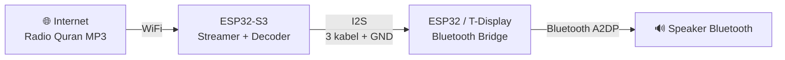

# 🕌 ESP32 Murottal Streaming 24/7: Radio Al-Quran Live ke Speaker Bluetooth, Tanpa Laptop

> **Streaming radio Al-Quran secara live dari internet**, lalu diputar **nonstop 24 jam**
> ke speaker Bluetooth apa saja. Tidak perlu simpan file MP3 dan tidak perlu SD card:
> audio langsung mengalir dari internet ke speaker. Cukup pakai **2 board ESP32 + 4 kabel
> jumper**. Hemat listrik (±1,5 watt), tanpa HP, tanpa laptop, tanpa modul tambahan.


---

## ✨ Fitur

- 📻 **Streaming radio Al-Quran live** dari internet (MP3)
- 🔊 **Kirim ke speaker Bluetooth** apa saja (A2DP)
- 🔁 **Auto-recovery penuh**: WiFi putus, stream macet, atau speaker mati, semuanya pulih sendiri
- 🔌 **Satu kabel USB** untuk dua board
- ⚡ **Super hemat listrik**: sekitar Rp2.000 per bulan, 20–40x lebih hemat dari laptop
- 🧩 **Tanpa modul tambahan**: tidak perlu DAC, SD card, atau Bluetooth transmitter

---

## 🧠 Cara Kerja



| Board | Tugas | Kenapa dipisah? |
|---|---|---|
| **ESP32-S3** | WiFi, ambil stream, decode MP3 | RAM besar (PSRAM 8MB), tapi **tidak punya Bluetooth Classic** |
| **ESP32 biasa** | Kirim audio ke speaker Bluetooth | Punya Bluetooth Classic, tapi **RAM tidak cukup** kalau WiFi + decoder + Bluetooth dijalankan bareng |

> 💡 **Kenapa tidak pakai 1 ESP32 saja?** Sudah dicoba berkali-kali. Hasilnya crash karena
> RAM habis dan bentrok WiFi + Bluetooth. Detailnya ada di [Pelajaran dari Percobaan](#-pelajaran-dari-percobaan).

---

## 🛒 Bahan

| Komponen | Keterangan | Kisaran harga |
|---|---|---|
| ESP32-S3 (disarankan **N16R8**) | Untuk streaming. Butuh PSRAM | Rp70–100rb |
| ESP32 original (WROOM-32) | Contoh: DevKit V1 atau **LilyGO T-Display v1.x** | Rp40–150rb |
| 4 kabel jumper female-female | | Rp5rb |
| Charger HP 5V minimal 1A | Lebih baik 2A | (pakai yang ada) |
| Speaker Bluetooth | Merek apa saja | (pakai yang ada) |

> ⚠️ **Penting:** board Bluetooth **WAJIB ESP32 original** (chip ESP32-D0WD / WROOM-32 / WROVER).
> **ESP32-S2, S3, C3, C6 TIDAK BISA** karena tidak punya Bluetooth Classic (A2DP).

---

## 🔌 Wiring

| ESP32-S3 | → | T-Display | (atau ESP32 DevKit) |
|---|---|---|---|
| GPIO 4 (BCK) | → | GPIO 26 | GPIO 14 |
| GPIO 5 (WS) | → | GPIO 25 | GPIO 15 |
| GPIO 6 (DATA) | → | GPIO 33 | GPIO 32 |
| **GND** | ↔ | **GND** | **GND** |
| 5V *(opsional)* | ↔ | 5V | 5V |

- **GND wajib disambung**, tanpa itu sinyal I2S tidak terbaca.
- Kabel **5V opsional**, supaya cukup satu USB. Colok USB ke **T-Display / ESP32 biasa**, nanti S3 ikut menyala.
  (Di beberapa board S3 clone, pin 5V hanya *input* kecuali jumper `IN-OUT` disolder.)
- ⚠️ Kalau kabel 5V tersambung, **jangan colok dua USB sekaligus**. Cabut kabel 5V dulu sebelum upload.
- Di ESP32-S3 N16R8, **jangan pakai GPIO 35, 36, 37** (dipakai PSRAM).

---

## 🚀 Instalasi

### 1. Siapkan Arduino IDE

1. Install [Arduino IDE 2.x](https://www.arduino.cc/en/software)
2. **File → Preferences → Additional Board Manager URLs**, isi:
   ```
   https://raw.githubusercontent.com/espressif/arduino-esp32/gh-pages/package_esp32_index.json
   ```
3. **Tools → Board → Boards Manager**, cari `esp32` (by Espressif), lalu install **versi 2.0.17**
   > Versi 3.x belum cocok dengan library ESP32-A2DP.

### 2. Install library

Download ZIP dari GitHub, lalu **Sketch → Include Library → Add .ZIP Library**:

| Library | Link |
|---|---|
| arduino-audio-tools | https://github.com/pschatzmann/arduino-audio-tools |
| arduino-libhelix | https://github.com/pschatzmann/arduino-libhelix |
| ESP32-A2DP | https://github.com/pschatzmann/ESP32-A2DP |

### 3. Upload ke ESP32-S3 (`s3_streamer`)

1. Buka `s3_streamer/s3_streamer.ino`
2. Ubah bagian **KONFIGURASI**: nama WiFi dan password
3. Setting di **Tools**:

   | Setting | Nilai |
   |---|---|
   | Board | ESP32S3 Dev Module |
   | USB CDC On Boot | Disabled *(kalau upload lewat port COM)* |
   | Flash Size | 16MB |
   | PSRAM | OPI PSRAM |
   | Partition Scheme | Huge APP (3MB No OTA/1MB SPIFFS) |

4. Upload, lalu buka Serial Monitor (115200). Angka `Data: ... KB` harus terus naik.

### 4. Upload ke ESP32 biasa / T-Display (`bt_bridge`)

1. Cari nama speaker Bluetooth kamu (lihat di menu Bluetooth HP saat pairing)
2. Buka `bt_bridge/bt_bridge.ino`, isi `speakerKeyword` (cukup sebagian nama)
3. Kalau pakai ESP32 DevKit biasa, ganti pin ke `14, 15, 32`
4. Setting di **Tools**: Board **ESP32 Dev Module**, Partition **Huge APP**
5. Upload, lalu nyalakan speaker. Tunggu sampai speaker bunyi *"connected"*

### 5. Sambungkan kabel, selesai! 🎉

Pasang 4 kabel sesuai tabel wiring, dan murottal langsung keluar dari speaker.

---

## 📻 Ganti Stasiun Radio

Ubah `streamURL` di `s3_streamer.ino`. Syarat URL-nya:

- ✅ Langsung berupa stream **MP3**
- ✅ Pakai **`http://`** dan **tidak redirect** ke https (paling stabil)
- ❌ Bukan link YouTube atau halaman web

Contoh yang sudah diuji:
```
http://66.45.232.132:9994/stream
```

> 💡 Banyak URL di direktori radio sudah mati. Tes dulu di browser atau VLC sebelum dipakai.

---

## 🛠️ Troubleshooting

| Masalah | Solusi |
|---|---|
| `BluetoothA2DPSource.h: No such file` | Library ESP32-A2DP belum terinstall |
| `Please read the ESP32-A2DP Wiki about the supported Platforms` | Board yang dipilih S3/C3/C6 (tidak bisa), atau core ESP32 versi 3.x. Pakai **2.0.17** |
| `Sketch too big` | Partition Scheme → **Huge APP** |
| Stream `Connect failed` terus | Server radio mati. Ganti `streamURL` |
| `Redirected to: https://...` berulang | Stasiun redirect ke https. Cari stasiun http lain |
| Speaker tidak connect | Cek `speakerKeyword`. Pastikan speaker tidak sedang tersambung ke HP |
| Suara terlalu cepat / lambat | Sample rate stasiun bukan 44.1 kHz. Ganti stasiun |
| Hening, tapi `Data` naik | Cek kabel I2S dan **GND** |
| Board sering restart sendiri | Charger kurang kuat. Pakai minimal 1A, kabel pendek |

---

## 📚 Pelajaran dari Percobaan

Proyek ini lahir dari banyak percobaan gagal. Semoga menghemat waktu kamu:

1. **ESP32-S3 / C3 / C6 tidak bisa A2DP.** Chip ini cuma punya BLE, tidak ada Bluetooth Classic.
2. **1 ESP32 (WiFi + MP3 decoder + Bluetooth) = crash.**
   - Library `URLStream` mematikan *WiFi modem sleep* secara default, padahal itu wajib saat Bluetooth aktif
     (`Should enable WiFi modem sleep when both WiFi and Bluetooth are enabled`).
     Bisa diakali dengan `url.setPowerSave(true)`.
   - Tapi setelah itu **RAM habis**: Bluetooth sekitar 100 KB, WiFi sekitar 50 KB, decoder sekitar 33 KB, dan sisanya kurang dari 20 KB.
     Stream https mustahil (TLS butuh sekitar 40 KB), dan stream http pun crash begitu audio mulai mengalir.
3. **Solusinya: bagi tugas ke 2 board.** S3 (RAM besar) urus internet, ESP32 urus Bluetooth saja.
   Hasilnya stabil.

---

## 🙏 Kredit

- [Phil Schatzmann](https://github.com/pschatzmann) untuk library **arduino-audio-tools**, **ESP32-A2DP**, **arduino-libhelix**
- Stasiun radio Al-Quran yang menyediakan siaran gratis

---

## 🤝 Kontribusi

Punya stasiun radio murottal http yang stabil? Board lain yang berhasil?
Silakan buka **Issue** atau **Pull Request**!

Kalau proyek ini bermanfaat, kasih ⭐ ya. Semoga jadi amal jariyah bersama. 🤲
